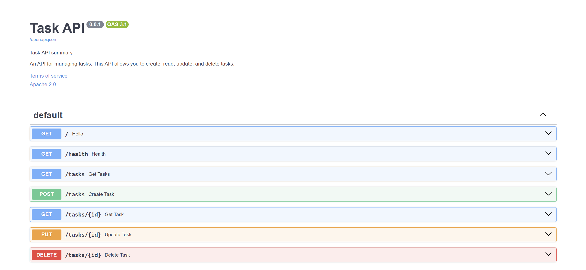

# Task Management API

A simple RESTful CRUD API built with **Python and FastAPI** as part of the **FlyRank Backend Development Internship — Week 2 Assignment**.

This API allows users to create, retrieve, update, and delete tasks. It uses in-memory storage and provides interactive documentation through Swagger UI.

## Features

- Create a new task.
- Retrieve all tasks.
- Retrieve a specific task by ID.
- Update a task's title or completion status.
- Delete a task.
- Check API health status.
- Interactive API documentation with Swagger UI.

## Technologies Used

- Python 3.10+
- FastAPI
- Pydantic
- Uvicorn
- Swagger UI
- Git & GitHub

## Installation and Setup

**1. Clone the repository**

```bash
git clone https://github.com/AbdalrahmanAlmalah/to-do-list.git
cd to-do-list
```


**2. Create a virtual environment**

```bash
python -m venv venv
```

**3. Activate the virtual environment**

On Windows:

```bash
venv\Scripts\activate
```

On Linux/macOS:

```bash
source venv/bin/activate
```

**4. Install dependencies**

```bash
pip install -r requirements.txt
```

**5. Run the server**

```bash
uvicorn main:app --reload
```

The API will be available at:

http://localhost:8080

## API Endpoints

| Method | Endpoint | Description | Success Status |
|---|---|---|---|
| GET | `/` | Returns API information | 200 OK |
| GET | `/health` | Checks API health | 200 OK |
| GET | `/tasks` | Retrieves all tasks | 200 OK |
| GET | `/tasks/{id}` | Retrieves a task by ID | 200 OK |
| POST | `/tasks` | Creates a new task | 201 Created |
| PUT | `/tasks/{id}` | Updates a task by ID | 200 OK |
| DELETE | `/tasks/{id}` | Deletes a task by ID | 204 No Content |

## Example Request

Create a task using POST `/tasks`.

**Request body:**

```json
{
  "title": "Learn FastAPI"
}
```

**Example successful response:**

```json
{
  "id": 4,
  "title": "Learn FastAPI",
  "done": false
}
```

Status Code: `201 Created`

## Testing with curl

Use the following command to retrieve all tasks:

```bash
curl -i http://localhost:8080/tasks
```


## Swagger UI Documentation

FastAPI automatically generates interactive API documentation.

Open:

http://localhost:8000/docs

Swagger UI allows you to test GET, POST, PUT, and DELETE requests directly from your browser.

**Swagger Screenshot**




## Data Storage

The application uses an in-memory Python list instead of a database.

All tasks are stored temporarily while the server is running. Changes made through the API are lost when the application restarts.

## Future Improvements

- Database integration.
- User authentication.
- Pagination and filtering.
- Automated API tests.
- Deployment to a cloud server.

## Author

FlyRank Backend Development Internship Participant

**Project:** Week 2 — Build Your First CRUD API


### Testing with curl

The API was tested using cURL on port 8080.

**Command:**

```bash
curl -i http://localhost:8080/tasks
```

**Actual Response:**

```http
HTTP/1.1 200 OK
date: Sat, 10 Oct 2026 11:47:27 GMT
server: uvicorn
content-length: 143
content-type: application/json

[{"id":1,"title":"Learn FastAPI","done":false},{"id":2,"title":"Build a REST API","done":false},{"id":3,"title":"Deploy the API","done":false}]
```

The request returned HTTP 200 OK and the list of tasks stored in memory.